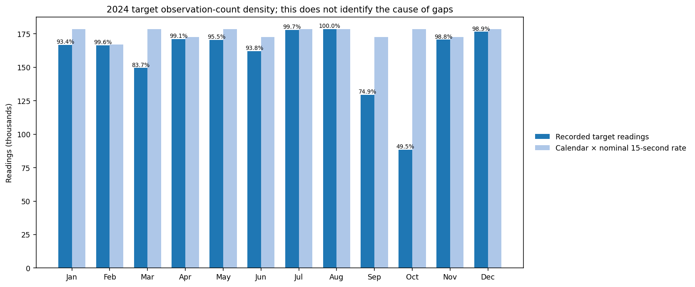
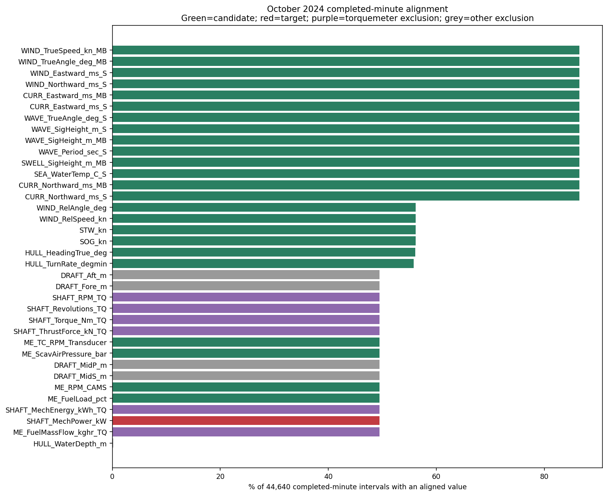
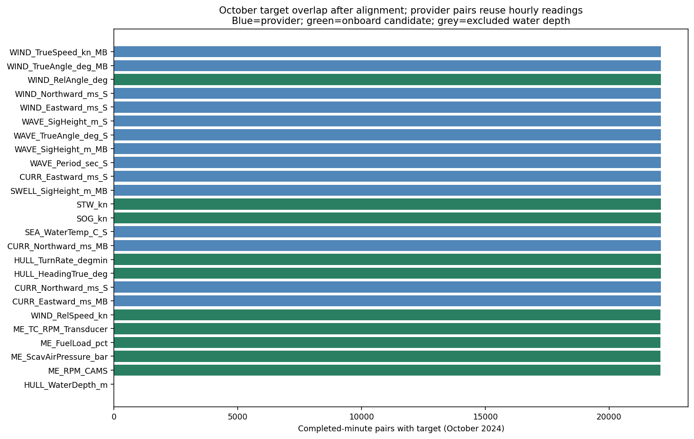
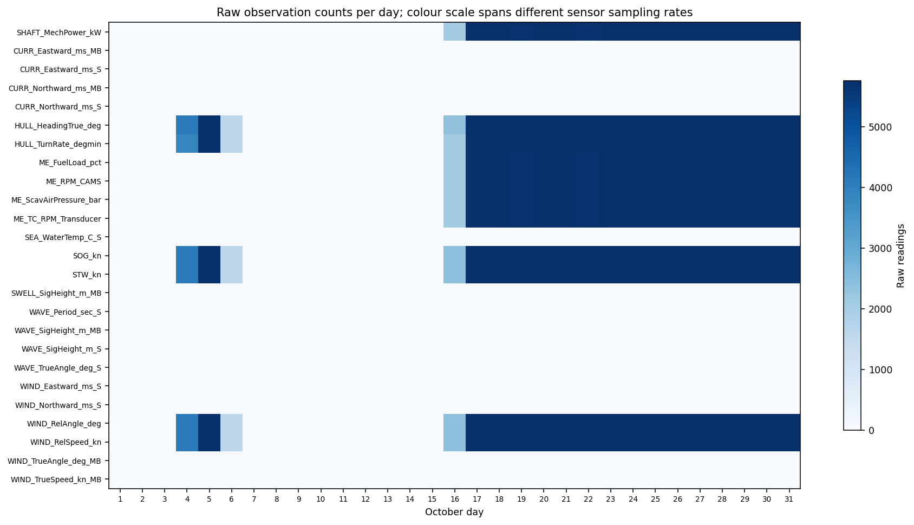
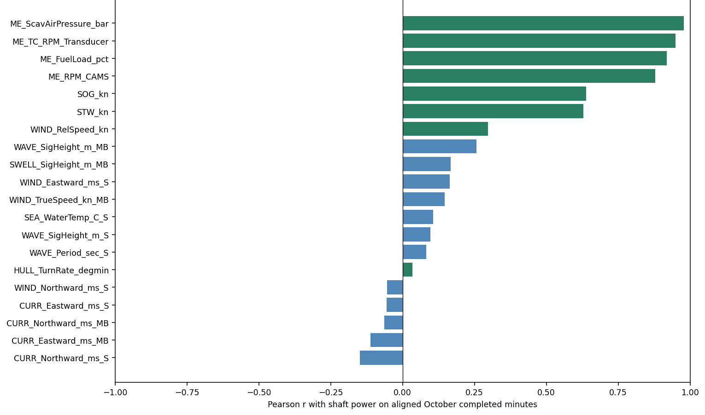
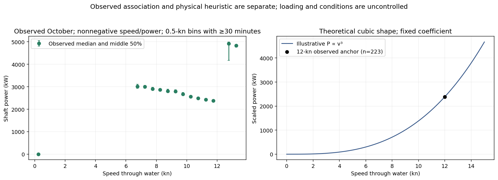

# Task 2 — Data Understanding and Background

SINTEF Ocean Real Vessel Data Challenge | TDT4259 Applied Data Science

**Version 2 · 30 October 2026 · Descriptive evidence and source suitability**

The numerical sensor findings and Figures 1–6 are retained from the delivered report of 25 October 2026. The completed scope audit supplies the added source-availability and Noon metadata findings. This revision does not recompute performance results or create a clean/current comparison. [R2, A1, A2]

## 1. Dataset inventory

The dataset contains **41,079,968 sensor records** in twelve 2024 monthly files and **1,112,405 records** for January 2025, giving **42,192,373 records** across thirteen files. The registration identifies **37 QIDs**: 36 occur in the 2024 data and 26 in January 2025. The registered channel without observed values is a turbocharger RPM indicator. All torquemeter channels, including shaft mechanical power, are absent in January 2025; it is not a labelled evaluation period for this target. [R2, D1, D2]

The existing quality scan parsed all 42,192,373 observed sensor values as finite numeric values and identified no malformed short records, numeric parsing failures or duplicate original `(timestamp, QID)` keys. Numeric completeness within recorded rows does not establish coverage across calendar time. These are retained findings, not a newly executed full-data audit. [R2]

### 1.1 Record structure and types

| Field | 2024 sensor records | January 2025 records |
|---|---|---|
| Timestamp | ISO 8601 text with a `Z` suffix and millisecond precision; parsed as a UTC-aware datetime. | Day-first timestamp text without a timezone; its actual timezone remains unconfirmed. |
| QID | Hierarchical text identifier, used as a categorical key. | Same text identifier type. |
| Sensor value | Numeric text parsed as `float64` / binary64. | Numeric text parsed as `float64` / binary64. |
| Number of Records | Not present; the files have three headerless fields. | Additional integer-formatted field in a four-field file with a header; aggregation meaning unconfirmed. |

The dictionary classifies the 36 observed channels as numeric after parsing and the unobserved registered channel as `not_observed`. Heading and direction have circular semantics despite numeric storage. The 2024 source records are not necessarily in chronological order; ordering must be handled explicitly. [R2, D1, D2]

Propulsion demand depends on speed through water, loading and trim, environmental resistance and operating state. Speed over ground is also influenced by current. The SINTEF presentation identifies these influences and the clean/current challenge calls for speed–power curves at different drafts. A defensible comparison therefore needs condition matching and a trustworthy reference, alongside a reliable power measurement. [C1, C3]

<!-- pagebreak -->

### 1.2 Compact source inventory

The table distinguishes measured sources, engineering references, output examples and evidence not located. “Not found” is limited to the inspected project package. Exact paths, archive-member checks and scope are recorded in the audit inventory. [A1, A2]

| Supplied source / availability | Relevant content and coverage | Suitability and unresolved evidence |
|---|---|---|
| **Sensor time series** — `data/raw/1.csv` through `12.csv`; `Jan25.csv` | 2024 measurements of power, speed, motion, engine and external conditions; January 2025 has 26 channels. | Current-condition observations need quality and comparability checks. January 2025 lacks shaft power; timezone/aggregation semantics remain uncertain. [R2, D2] |
| **Noon Reports** — 12 CSVs under `data/Noon Reports/` | All 366 dates of 2024; forward, mid and aft draft, displacement, environmental fields, propulsion consumption and fuel type. | Daily loading context; units, observation/issue times and within-day representativeness need confirmation. No cleaning field or direct speed–power pair. See §5. [N1, A1] |
| **Vessel particulars** — `docs/Vessel/Particulars.xlsx` | Four loading conditions; dimensions, wetted areas, displacement volumes, engine ratings and propeller particulars. | Reference configuration only. Displacement volume is labelled m³; Noon displacement units are unconfirmed. [V1] |
| **Sea-trial curves** — `docs/Vessel/Sea_Trials_curves.jpg` | Image of model and measured speed–power curves at design draft and ballast; axes Pd (kW), Vs (kn). | Trial date, cleanliness, conditions, corrections, numeric table and power-definition provenance are not established by the image. [V2, A1] |
| **Towing-tank report** — reference [V3] | Full-scale predictions from model tests for four draft conditions, with/without PSV; clean bottom, calm sea and sufficient depth explicitly assumed. | Candidate engineering clean reference. Confirm actual configuration, loading, speed range, margins and power location. It does not label a dated sensor period clean. |
| **Cleaning-event records** — not found in the inspected package | Announced by the challenge, but no actual event log located. | Event dates, temporal completeness, cleaning extent, component and clean-state evidence are unknown; event quality cannot be assessed. [A1, A2] |
| **Actual engine shop-test report/map** — not found in the inspected package | Engine ratings and propeller/towing tests are available. | Those references do not supply a measured engine fuel/load map or justify a fuel-saving estimate. [A1, A2] |
| **Supplied CSV templates** — two files under `docs/Templetes/` | Clean-baseline curve layout and example time-series output fields, including expected power, fouling and `clean` flags. | Examples, not ground-truth measurements or maintenance records. An example clean flag supplies no cleaning date. [X1, A1] |

### 1.3 Engineering reference versus observed clean condition

The towing-tank report supplies a clean-bottom engineering assumption. **It does not prove a dated clean condition in the observed sensor series.** The audit found no verified cleaning chronology or clean-labelled sensor interval. The sea-trial image is a candidate reference whose provenance still needs confirmation. No first month, post-gap period or template timestamp is assigned a clean label here. [V2, V3, A1]

<!-- pagebreak -->

## 2. Sampling, temporal alignment and coverage

Sensors operate at different rates and timestamps. A wide table formed from their union has empty cells even when individual sensors recorded correctly. Three October denominators answer different questions. [R2]

| October target measure | Result | Interpretation |
|---|---|---|
| Numeric values among recorded target rows | 88,304 / 88,304 | No null numeric value within recorded target rows. |
| Target presence on raw union-timestamp grid | 88,304 / 376,474 | About 76.5% of cells blank, largely because timestamps differ; not calendar coverage. |
| Target presence on completed-minute grid | 22,088 / 44,640 | 49.48% of calendar minutes represented by a target observation. |

For the existing October descriptive analysis, onboard readings are averaged in trailing **one-minute intervals labelled by their end**. The grid spans 1 October 00:01 through 1 November 00:00, representing October's 44,640 minutes. Each environmental value comes from the latest raw timestamp no later than the interval end, with a maximum age of 60 minutes. This is a completed-minute description, not a forecast at the minute's start. A past raw timestamp does not establish provider issuance or operational availability; issue time, valid time and timezone semantics remain unconfirmed. [R2, M1]

Each of the **14 external channels** has 643 raw October readings, **38,601** aligned calendar-minute values (86.47%) and **22,088** target-paired minutes. These pairs use only **369 distinct provider timestamps** per channel. Scavenging-air pressure is onboard: **22,092** completed minutes and **22,087** target pairs. Water depth has **61** completed minutes and **zero** target overlap in October. Figures 2–3 retain the coverage/overlap displays. [R2]

### 2.1 Monthly observation-count density

The table uses a nominal uninterrupted 15-second calendar denominator. It describes recording density, not verified sensor uptime or the cause of gaps. Figure 1 retains the corresponding chart. [R2]

| Month, 2024 | Recorded target readings | Nominal density | Negative readings |
|---|---:|---:|---:|
| January | 166,699 | 93.4% | 115 |
| February | 166,389 | 99.6% | 111 |
| March | 149,512 | 83.7% | 30 |
| April | 171,160 | 99.1% | 20 |
| May | 170,498 | 95.5% | 189 |
| June | 162,159 | 93.8% | 0 |
| July | 178,007 | 99.7% | 28,544 |
| August | 178,534 | 100.0% | 495 |
| September | 129,509 | 74.9% | 138 |
| October | 88,304 | 49.5% | 37 |
| November | 170,683 | 98.8% | 656 |
| December | 176,579 | 98.9% | 166 |

October power occurs on **16 of 31 dates**. Reduced September/October density requires coverage-aware interpretation. Noon dates span 2024, but cleaning-event dates and pre/post-event overlap are unknown. January 2025 cannot define a measured power curve without its missing target. A “current” comparison window must therefore be explicitly dated and justified. [R2, A1]

<!-- pagebreak -->

## 3. Sensor quality and candidate measurements

The original power-reconstruction proposal accounts for the 36 observed 2024 channels as follows. These roles are retained as data-understanding context; they are not a validated input specification for a clean-condition comparison. [R1, R2]

| Role in the original proposal | Channels | Documented treatment |
|---|---:|---|
| Shaft mechanical power | 1 | Target; reliability requires assessment. |
| Torquemeter-related channels or close proxy | 6 | Excluded to reduce direct target leakage. |
| Constant-zero draft measurements | 4 | Excluded as noninformative sensor readings. |
| Echosounder water depth | 1 | Excluded initially because there is no October target overlap. |
| Candidate predictors | 24 | Four other-source engine, four motion, two onboard relative-wind and fourteen provider channels. |

The four draft sensors have **8,226,522 values** across thirteen files, all **0.0 m**. They supply no useful draft variation; this does not establish installation, reporting or export cause. Water depth can be reconsidered for other periods only if its meaning and overlap are established. Noon draft/displacement fields may provide coarse loading context, subject to §5. [R2, M1]

Eastward and northward sea-current variables are assigned to their corresponding provider sources in m/s; sea-water temperature is in degrees Celsius. Shaft revolutions has no specified unit in the registration. Heading and wind/wave directions require circular processing, and are excluded from the plain Pearson display. Source labels do not by themselves establish engine-signal independence, latency or availability at a decision time. [R1, R2, D1, D2]

### 3.1 Target-power anomalies

**July 2024:** 28,544 negative readings occur across fourteen dates. All target readings on 11, 12 and 15 July are negative, and the longest near-contiguous negative sequence is 17,399 readings. At completed-minute resolution, **6,948 negative-power intervals** coincide with positive CAMS engine RPM and speed through water above 3 kn. [R2]

**November 2024:** 656 negative readings occur across eight dates, with a minimum near **−24,757 kW**. The same negative-power, positive-CAMS-RPM and above-3-kn condition occurs in **93 completed-minute intervals**. The signed value agrees with the supporting draft and validation record. [R2, M1, S1]

These patterns warrant separate target-quality investigation. They do not identify calibration errors, reversal, sign convention or exact fault boundaries. The challenge warns of torque miscalibration in parts of the data; corresponding operation/calibration records are still needed. Negative values have not been silently clipped or replaced in this revision. June's absence of negative readings is not proof of clipping. December has 166 negative readings; the historical evaluation-policy caveat is preserved in Appendix A. [C3, R2]

Trustworthy target measurements are essential for comparison with a clean reference: a sensor shift can appear as a power difference. Likewise, an engine signal that closely follows power may support reconstruction while reflecting current degradation. Neither an apparently plausible estimate nor a strong association establishes clean-condition demand. Figures 2–4 retain the existing coverage evidence. [R2, A1]

<!-- pagebreak -->

## 4. Relationships observed in October

The retained Pearson analysis describes aligned October minutes for scalar candidate variables. Torquemeter-related features, constant draft, sparse water depth and circular directions were excluded. The values below and Figures 5–6 are existing descriptive results; no relationship was refitted for v2. [R2]

| Measurement | Pearson correlation with shaft power | Paired minutes |
|---|---:|---:|
| Scavenging-air pressure | +0.978 | 22,087 |
| Turbocharger RPM, transducer | +0.950 | 22,087 |
| Engine fuel load (%) | +0.920 | 22,087 |
| Engine RPM, CAMS | +0.880 | 22,086 |
| Speed over ground | +0.638 | 22,088 |
| Speed through water | +0.628 | 22,088 |
| Significant wave height, Provider MB | +0.256 | 22,088 |

Strong engine associations suggest potential information for power reconstruction, subject to availability and independence checks. Weather correlations reuse hourly values and serially related target minutes: **22,088 pairs are not 22,088 independent weather observations**; only 369 distinct provider timestamps contribute. These associations are neither causal effects nor trained-model feature importances. [R2]

The October speed–power relation is not consistently increasing. Among nonnegative speed and power intervals, median power decreases from approximately **2,997 kW at 7.0–7.5 kn** to **2,564 kW at 10.0–10.5 kn** and **2,431 kW at 11.0–11.5 kn**. The existing unconstrained descriptive cubic falls from approximately 2,955 kW at 7 kn to 2,576 kW at 10 kn. These retained observations do not establish the vessel's resistance law. [R2]

The idealized relationship of power proportional to speed cubed is a physical heuristic under assumptions not established for these pooled observations. Loading, operating conditions, time/voyage effects and measurement quality have not been controlled sufficiently to explain the empirical decline. Regime mixing is not established as its cause. Figure 6 shows the illustrative theoretical shape separately from observed summaries. [R2, M1]

**Implication for the business question:** this EDA supplies neither a clean/current label nor an estimate attributable to fouling. A future comparison needs an applicable reference and matched or justified corrections for speed, loading, trim, environment and operating state, with uncertainty carried through. No clean/current comparison is produced here. [C1, C3, A1]

The six original figures are reproduced unchanged in Appendix B, retaining their numbering and substantive captions. Their source images were extracted from the authoritative delivered Task 2 PDF, rather than regenerated from data.

<!-- pagebreak -->

## 5. Noon Reports and implications for modeling

The twelve Noon Report CSVs contain **366 valid unique dates**, covering every date in leap year 2024. Their daily cadence is much coarser than sensor records. Forward, mid and aft draft and displacement are populated on all 366 dates and could support coarse loading descriptions. The supplied column headings do not confirm their units. The particulars workbook explicitly reports displacement volume in m³, so equivalence to Noon displacement must not be assumed. Draft definitions, trim derivation, units and any density conversion require confirmation. [R2, N1, V1, A1]

Observation and issuance times are unknown. A same-day value may not have been available early that day or represent loading throughout it. A defensible lag may address online availability, but can misrepresent loading changes; retrospective comparison also needs evidence of the loading applicable to the sensor interval. [R2, A1]

The existing audit flags **18 extreme slip entries**, including −60% and +50%; these are review flags, not cleaning indicators. The scope audit found **116 blank propulsion-consumption entries and 116 blank fuel-type entries** across the year, including all 30 June dates. Blank values do not imply zero consumption. One loading item requiring review is the 31 March record: forward draft 5, mid 5.93, aft 1.29 and displacement 34015. Its definitions/transcription require checking before trim or reference matching; it is not declared erroneous here. [R2, N1, A1]

There is no cleaning-event field or cleaning-related entry in the inspected Noon CSVs. The original month split has been relocated to Appendix A to preserve its historical specification while keeping this section data-oriented. [A1, A2]

## 6. Interpretation and limitations

The package offers candidate engineering reference material and substantial operational observations, but it does not establish a dated clean state in the sensor series. Cleaning-event records and an actual engine shop-test report/map were **not found in the inspected package**. Cleaning-event coverage, completeness, timing precision, component/extent and post-clean condition cannot be assessed without those records. Promised data and example `clean` flags do not resolve this absence. [A1, A2]

Reference use requires the correct PSV configuration and loading/trim, an appropriate speed range, comparable environment/depth and operating state, compatible power definitions/measurement location, documented corrections and uncertainty. The towing report assumes calm sea, sufficient depth and a clean bottom. Its with/without-PSV percentages are not cleaning savings. The trial chart's 8833 and 0.985 annotations and the towing report's 9500 kW rating and 0.99 transmission efficiency require reconciliation; their difference alone does not establish a vessel mismatch. [V2, V3, A1]

Requests needed to close these gaps are dated cleaning/inspection and maintenance history; reference/trial provenance and numeric curves; calibration/operation logs; loading, weather and timestamp metadata; and a defined current-condition window and decision horizon. These requests support feasibility assessment, not an assertion that fouling has occurred. [A1]

The retained descriptive findings do not establish predictive accuracy, fuel savings, cleaning effectiveness or deployment readiness. Provider timing, engine-signal availability, loading representativeness and reliable target periods remain open. Completed-minute reconstruction does not establish a real-time or advance route-planning forecast. The pending Task 3 work has not been assessed in this revision. [R2]

<!-- pagebreak -->

## Appendix A. Preserved technical proposal from 25 October 2026

This appendix relocates technical specifications from delivered Task 1 §§1–5 and Task 2 §5. It preserves their historical status as proposals; it does not reassess them against later work, report experiments or establish a clean-condition model. Current Task 3 decisions remain pending and outside this revision. [R1, R2]

### A.1 Target and reconstruction formulation

The original task is supervised regression of **Vessel Propeller Shaft Mechanical Power (kW)**, registered QID:

`2::0::11::0_1::1::0::3::0_14::0::1::0_8`

Each example describes a completed one-minute interval. Onboard measurements are summarized at its end; the target is recorded power for that interval. This is not a prediction of the following minute, an instantaneous estimate at the beginning of the minute, or a demonstrated route-optimization system. January 2025 has no target for labelled evaluation. Provider data use the past-timestamp rule in §2, with availability unresolved. [R1, R2]

The original exclusions cover torque, mechanical energy, thrust, shaft revolutions, shaft RPM and torquemeter-sourced fuel mass flow; four zero-draft channels; and initially water depth because of absent October overlap. The 24 candidates include engine RPM, turbocharger RPM, scavenging pressure, fuel load, vessel speeds/motion, relative wind and 14 provider channels. These source labels/roles do not prove operational independence or a valid clean-condition feature set. [R1, M1]

### A.2 Historical development and evaluation periods

| Period | Original assigned role | Original rationale |
|---|---|---|
| January–June 2024 | Primary training | Earlier labelled observations; quality rules before fitting. |
| July 2024 | Quality investigation | Sustained negative-power episode. |
| August 2024 | Validation | Later period for method/parameter decisions. |
| September–October 2024 | Coverage stress analysis | Reduced observation-count density. |
| November 2024 | Quality investigation | Extreme negative outliers and further suspect readings. |
| December 2024 | Untouched primary test | Later assessment once methods are fixed. |

The original rationale avoids randomly mixing adjacent sensor minutes across training/testing. December's 166 negative readings require a policy fixed without inspecting test prediction errors and disclosure of excluded cases. July and November remain outside the original primary fitting/headline-testing proposal unless reliability is established. These statements describe the delivered proposal, not the status of later experiments. [R1, R2]

### A.3 Historical technical success measures

The original proposal specifies MAE and RMSE in kW, supplementary R², observation counts, time-block/operating-condition reporting and simple baselines: a training-mean estimate, a speed-based heuristic fitted only on training data, and persistence only when a preceding trusted power observation would actually be available. It seeks meaningful improvement on untouched chronological data. Operational tolerance requires stakeholder requirements; model accuracy alone cannot establish maintenance value. No metric values or achieved improvements are asserted. [R1]

<!-- pagebreak -->

## Appendix B. Retained descriptive figures

All six figures are unchanged source images from the delivered Task 2 report [R2]. Their numbering is retained; no figure represents a newly computed result or a clean/current comparison.

<!-- pagebreak -->

### Appendix B continued — overlap and daily counts

<!-- pagebreak -->

### Appendix B continued — descriptive relationships

Loading, environmental conditions, voyage/time effects and measurement quality have not been controlled sufficiently to explain the observed decline. These figures do not establish fouling, a dated clean state or a cleaning benefit. [R2, A1]

<!-- pagebreak -->

## References and edition provenance

Paths are relative to the project root. PDF page references count physical pages; printed slide/page numbers are stated where different.

[R1] `Task 1 Report.pdf`, 25 October 2026, pp. 1–2: authoritative original technical specification.

[R2] `Task 2 Report.pdf`, 25 October 2026, pp. 1–7: authoritative retained sensor findings, tables, six figures and limitations.

[C1] `docs/challenge/HullPIC25 Announcement.pdf`, PDF pp. 1–3 (printed pp. 117–119): promised sources; clean/current curves by draft; added power/speed loss; quality/uncertainty.

[C3] `docs/SINTEF_Ocean_v2.pdf`, PDF pp. 5–7, 10 and 13: performance influences, advertised data, miscalibration warning and business questions.

[A1] `outputs/task1_task2_scope_audit/internal_findings.md`, 30 October 2026, §§3–7: bounded source search, reference suitability, Noon checks and remaining requests.

[A2] `outputs/task1_task2_scope_audit/source_inventory.csv`: file-level and archive-member evidence; search limitations and exact paths.

[D1] `docs/Metrics registration - Google Sheets.pdf`, pp. 1–2: registered channel quantities, sources and units.

[D2] `outputs/tables/data_inventory.csv`, `data_dictionary.csv`, `qid_per_file.csv` and `qid_reconciliation.csv`: existing inventory and channel-presence metadata, as inspected in the scope audit.

[V1] `docs/Vessel/Particulars.xlsx`, Sheet1 B3:F80: design/scantling/ballast/heavy-ballast particulars; draft pairs 12.20/12.20, 14.25/14.25, 5.00/7.80 and 4.40/9.40 m; engine and propeller data.

[V2] `docs/Vessel/Sea_Trials_curves.jpg`: supplied Pd–Vs image with model/measured design-draft and ballast curves; provenance limitations documented in [A1].

[V3] `docs/Vessel/TOWING TANK MODEL TEST REPORT for A 76000DWT Bulk Carrier with&without PSV.pdf`, PDF pp. 6–8 and 10–14, especially p. 12 (printed p. 11): loading/configuration, power definitions and clean-bottom assumptions.

[N1] Twelve CSVs under `data/Noon Reports/`, individually inventoried as NOON01–NOON12 in [A2]. The 31 March loading review item is in `N03_March_Data_with_Propulsion_and_Fuel.csv`, CSV line 32. Annual missingness/field checks are recorded in [A1] §5.

[X1] `docs/Templetes/BillTsars_Model1_CleanBaselineScantling.csv` and `BillTsars_Model1_Timeseries.csv`: example output layouts; no ground-truth cleaning-event evidence.

[M1] `outputs/reports/task1_preliminary.md` and `task2_preliminary.md`, 25 October 2026: related drafts used for cross-checks, not assumed to be exact original PDF sources.

[S1] `Scientific_Validation.pdf`, 25 October 2026, pp. 1–2: supporting descriptive/data-quality scope and signed negative-power evidence; not a validation of clean-state attribution.

**Edition provenance:** New authoritative v2 editable source reconstructed from the delivered PDFs and supporting drafts. The figures were extracted from the delivered Task 2 PDF and retained without recalculation. An exact editable source/build chain for the original PDFs was not found in the inspected scope. Historical originals and audit artifacts remain preserved.
