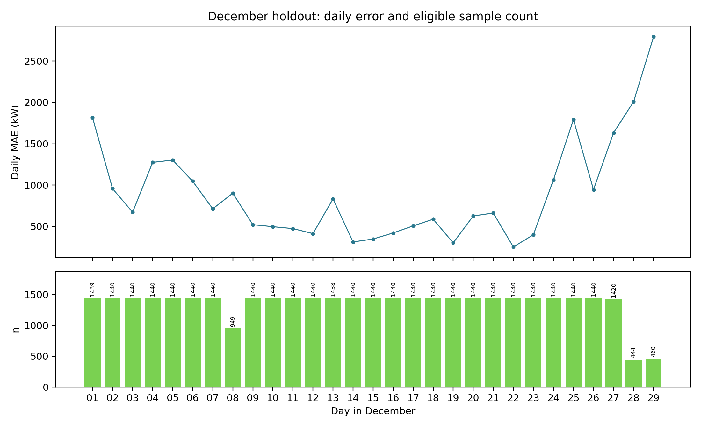
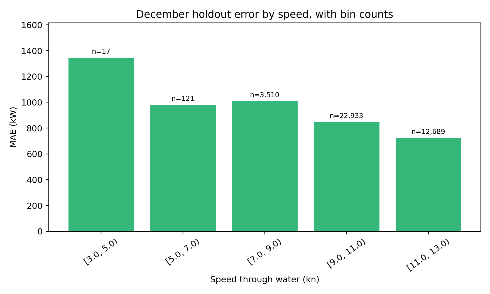
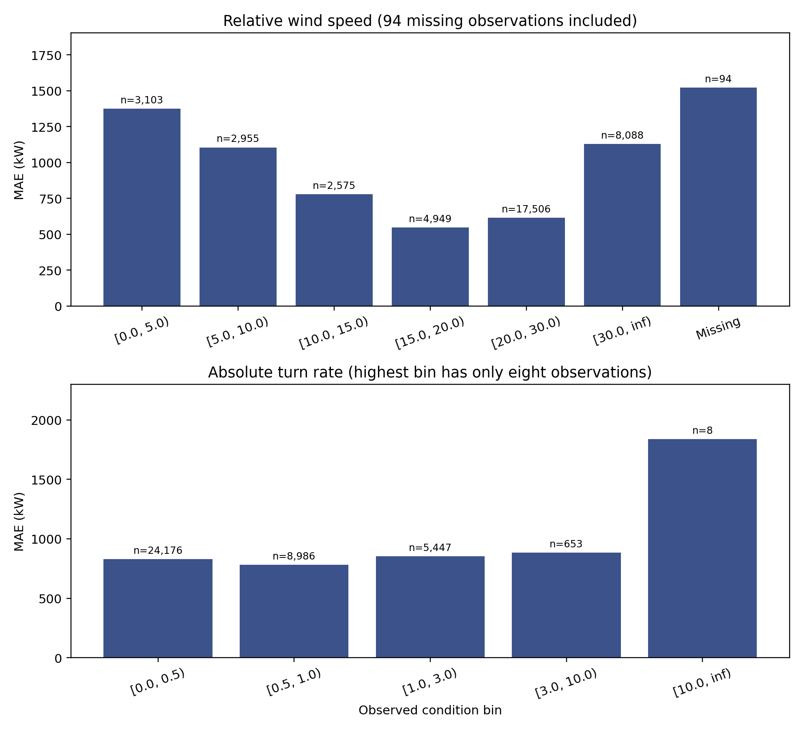

# 01. Title and abstract

Task 3: Methods, Analysis and Technical Evaluation. SINTEF Ocean Real Vessel Data Challenge, NTNU TDT4259. Scientific technical report, 25 October 2026. The donor vessel and shipowner remain unidentified.

This study streams 41,079,968 confidential 2024 sensor records into completed-minute representations, compares two machine-learning families and two training-only baselines, selects on August, and evaluates a frozen model once on December. The December headline result is MAE 822.3 kW, RMSE 1,064.4 kW, Pearson r 0.004, and R² -7.953 on 39,270 eligible minutes. The discrepancy between MAE and R² is central: useful average-error improvement does not establish minute-scale tracking or operational readiness.

# 02. Research question and estimand

The research question is how well completed-minute vessel measurements estimate contemporaneous shaft mechanical power under a declared forward-underway scope. The analysis is retrospective. A completed-minute estimate can be calculated only after the interval ends; it is not an instant forecast at interval start.

The response is minute-mean shaft power in kilowatts. The primary metric is mean absolute error on a predeclared target-conditional headline subset, accompanied by root mean squared error, Pearson correlation and coefficient of determination. A broader forward-speed evaluation exposes sensitivity to zero and negative labels. These two scopes answer different questions and are presented together.

# 03. Prior data-understanding context

The preliminary Task 1 and Task 2 work identified 37 registered QIDs, 36 observed 2024 QIDs, 24 candidate channels, four constant-zero draft channels, and six torquemeter-associated channels excluded as inputs. It also identified substantial July and November target concerns and lower September–October target observation-count density.

The present analysis retains that source mapping and chronological split. It does not infer why anomalous power values occur. Earlier descriptive correlations and theoretical speed–power curves are not treated as proof of predictive performance. The task here is a reproducible supervised comparison under explicit target and timestamp rules.

# 04. Sensor inventory and observation unit

The raw 2024 files contain timestamp, QID and value fields in long form. There are 41,079,968 sensor rows across twelve monthly files. The model-ready representation contains 527,040 calendar minute rows, including minutes without a target or particular predictor. This full grid makes missingness and observation density visible.

Individual minutes are not independent trials. Onboard channels can have several readings per minute; provider channels can be much sparser and repeated across minute rows. The reported sample count therefore denotes scored completed minutes rather than independent weather measurements, voyages or causal interventions.

# 05. Registered variables and source mapping

Every selected variable is addressed by an explicit registered QID and source classification. Onboard channels and the two external providers are distinguished by that mapping, not by fragments of a display name. This matters for main-engine scavenging-air pressure, whose name could otherwise be mistaken for an environmental channel.

The power target is retained only as a label. Torquemeter-associated RPM, torque, energy, thrust and fuel-flow proxies are excluded from inputs. Constant-zero draft channels and the sparse depth channel are also outside the primary feature sets. This leaves 24 preliminary candidate channels before transformations and missingness descriptors.

# 06. Raw time representation

The 2024 timestamp strings carry a UTC Z suffix. A row labelled t in the derived table represents an onboard interval [t−1 minute, t). Exact observations at t belong to the next completed minute. This half-open convention prevents an observation at the decision boundary from entering the prior interval.

The January 2025 file uses a different, timezone-naive representation and has no shaft-power target. It is excluded from supervised model fitting and holdout evaluation. The present work makes no assumption about its actual timezone.

# 07. Quality findings retained from audit

All observed sensor values had been parsed as numeric in the prior full-file quality audit, but numeric parseability does not establish physical validity. Four draft channels recorded only zero and are excluded. Negative shaft power occurs in several months, especially July and November; its cause and operating interpretation remain unresolved.

The analysis does not call every negative value a sensor failure. It defines a forward-underway headline estimand and separately scores the broader forward-speed set. Exact target-reading counts are reconciled with the preliminary data audit, and raw records are never overwritten.

# 08. Memory-bounded construction

Each monthly source is streamed in chunks of 200,000 raw rows. Accumulators are indexed by QID and calendar minute, so the full long-format year is never loaded and no large union-timestamp pivot is materialized. One monthly feature table is compressed before the next month is processed.

The output retains explicit source-month, onboard reading-count, target-quality and external source-age fields. Across twelve months the compressed minute tables occupy approximately 41 MB. This design was executed on a CPU-only Windows laptop under an 8 GB RAM constraint; peak memory was not instrumented.

# 09. Onboard aggregation contract

Onboard scalar values are arithmetic means over [t−1 minute, t), labelled by the end t. Counts preserve how many raw readings contributed. A missing channel remains missing; no value is silently drawn from a future interval or across a split boundary.

The target minute mean is paired with its raw reading count, minimum and count of negative readings. Those fields define evaluation eligibility and are excluded from the predictor array. Model fitting uses completed-minute rows, so any eventual real-time implementation must establish when every onboard input becomes available after t.

# 10. Circular measurements

True heading, relative wind angle and provider angular fields are circular. Arithmetic averaging of degrees would put 350° and 10° near 180°, which is physically wrong. For onboard angles, sine and cosine are averaged and the direction is obtained by atan2. Resultant length records directional concentration within the minute.

Models receive sine and cosine instead of raw angle degrees; onboard angle resultant length and reading count are additional descriptors. A synthetic boundary test verifies that 350° and 10° aggregate near 0°, and that no observation from the next minute enters the result.

# 11. External channel provenance

For each external provider variable, the table uses the latest raw timestamp before the completed-minute end, provided that its age is at most 3,600 seconds. Per-channel source age accompanies the retained value. Once a value exceeds the maximum age it becomes missing.

This is a retrospective timestamp rule only. The data do not establish whether a provider timestamp denotes issuance or weather validity, and therefore do not establish that the value was available at the operational decision instant. External feature set C is exploratory and cannot be interpreted as a causal real-time forecast.

# 12. Candidate feature hierarchy

Feature set A contains six restricted onboard channels: speed through water, speed over ground, true heading, turn rate, relative wind speed and relative wind angle. It is the smallest operationally oriented feature set evaluated here. Its transformed input array contains sixteen value, circular and count columns.

Feature set B adds four main-engine channels. Feature set C adds fourteen external provider channels to B. All three sets share the same target and chronological validation rule. Their comparison examines whether more retrospective information improves August absolute error, while recognizing that operational latency for engine signals and issue-time semantics for external channels are not verified.

# 13. Input exclusions and leakage

The model input array is an explicit list of approved transformed columns. It does not contain the target, target minimum, negative-reading count, target count, torquemeter RPM, torque, mechanical energy, thrust, torquemeter-associated fuel flow, constant-zero drafts, or water depth.

The same-day Noon Report variables are not joined because their publication timing relative to the completed-minute prediction is unknown. The observed target is used to define evaluation subsets, never as a predictor. This distinction is essential: target-conditional scoring is a retrospective evaluation convention, not a deployable eligibility flag.

# 14. Target-conditional primary scope

The frozen headline rule requires an observed target, speed through water at least 3 kn, a positive minute-mean target, nonnegative raw target minimum and zero negative raw target readings in that minute. It describes selected forward-underway labelled minutes. The 3 kn boundary is an operational scope choice, not a calibrated fault threshold.

At inference time, shaft power is the quantity being estimated, so its sign and within-minute minimum are not known. A deployed system cannot first inspect the target and then decide whether to predict. Headline MAE must therefore never be read as unconditional operational coverage or an automatic data-quality filter.

# 15. Broader forward-speed sensitivity

The broader set requires only an observed target and speed through water at least 3 kn. It retains zero and negative power labels. This is a more inclusive retrospective comparison, though the meaning of negative values is unresolved. It is presented prominently because the headline subset can exclude scientifically important cases.

The stress-period selected-model MAE rises from 884.1 kW on 38,517 headline minutes to 2,009.8 kW on 52,502 broader forward minutes. December changes much less, from 822.3 to 823.8 kW, because only 43 December forward minutes fall outside the headline rule.

# 16. Headline eligibility by period

Eligibility varies materially across splits. The table reports the fraction of forward-speed minutes with a target that also satisfy the target-conditional headline rule. It is not an estimate of deployment-time eligibility, because target values are required to apply it.

The low September–October rate is especially consequential for evaluating coverage stress. Comparing headline metrics alone would obscure the many forward minutes with zero or negative target conditions. July and November remain outside ranked evaluation while the target-quality questions are investigated.

| Period | Forward n | Headline n | Eligible % |
| --- | --- | --- | --- |

| Jan–Jun | 184,295 | 166,154 | 90.2 |

| August | 41,205 | 35,086 | 85.1 |

| Sep–Oct | 52,502 | 38,517 | 73.4 |

| December | 39,313 | 39,270 | 99.9 |

# 17. Chronological evaluation design

January–June 2024 is training; July is quality quarantine; August is validation and model selection; September–October is coverage stress; November is quality quarantine; December is the untouched holdout. This ordering was fixed before the one-time December score was calculated.

No random minute split is used. A random split would allow temporally adjacent, autocorrelated operating observations to appear on both sides of the validation boundary. Month-level separation is stricter, although it still cannot guarantee independence among voyages or environmental states.

# 18. Fit-time transformations

Median imputation and missingness flags are inside each fitted pipeline. Ridge also fits a standard scaler inside the training pipeline. No imputation statistic is computed from August, September–October or December. The saved final imputer medians were independently compared with medians of the eligible January–June rows.

Provider age and onboard count columns describe data availability. They may help a retrospective model distinguish sparse observations, but their presence does not repair unknown issue-time semantics or operational latency. Missing channels remain explicitly marked until the training-only transformation is applied.

# 19. Training-mean comparator

The training-mean baseline predicts one constant power value for every eligible row. It is fitted only from January–June labels. Because its predictions are constant, Pearson correlation with the observed target is undefined; a zero or machine-roundoff value would be misleading.

On December headline minutes this comparator has MAE 2,568.4 kW, RMSE 2,592.9 kW and R² -52.128. Its large error reflects a strong difference between training and December target distributions. The baseline supplies an honest low-complexity reference, not an operational recommendation.

# 20. Speed-cubic comparator

A constrained comparator has the form P = a + b × STW³, with nonnegative a and b fitted on January–June by nonnegative least squares. It is physically motivated as a simple speed-related power scale, but it is empirical. Draft, displacement, current, sea state and operating regime are not held fixed.

The December headline speed-cubic MAE is 1,944.2 kW, RMSE 1,989.1 kW, Pearson r 0.191 and R² -30.265. Its error is lower than the training mean yet far above a December-specific mean benchmark. This does not establish a universal monotone observed speed–power law.

# 21. Ridge Regression

Ridge Regression is one of the two trained machine-learning families. Median imputation, missingness indicators and standardization are fitted on training data, followed by L2-regularized linear regression. Alpha values 10 and 100 were compared within each of A, B and C.

Ridge offers a relatively transparent baseline for mixed onboard and weather inputs, but linearity and additive effects are restrictive. The evaluation did not train XGBoost, CatBoost or Random Forest. No claim is made about those untested families or about an optimal model class.

# 22. Histogram gradient boosting

HistGradientBoostingRegressor is the second trained machine-learning family. It was run with 120 boosting iterations, learning rate 0.07, minimum leaf size 80, L2 regularization 1, and either 15 or 31 leaves. Imputation and missingness indicators were fitted inside the training pipeline.

The bounded search was designed for a CPU-only 8 GB laptop. The learner can represent nonlinear interactions, but this does not make its behavior physically interpretable or stable across calibration and operating-state changes. No December result was used to select leaf count, learning rate or feature set.

# 23. Selection budget and candidate families

Each candidate was fitted on the same deterministic, uniformly spaced sample of 120,000 eligible January–June rows and evaluated on all 35,086 eligible August rows. After August selected one configuration, that configuration was fitted once on all 166,154 eligible training rows.

Only Ridge Regression and histogram gradient boosting were evaluated as machine-learning families, alongside the training mean and constrained speed-cubic baselines. This deliberately small search limits resource use and selection multiplicity. Other model families would require a new protocol justified by earlier-period validation, with a new untouched holdout for future claims.

# 24. August selection comparison

The primary selection criterion was August MAE. A restricted onboard boosting model with 15 leaves was the lowest-MAE candidate. More elaborate feature sets often had higher Pearson correlation but worse absolute error, revealing systematic level differences that correlation alone hides.

The asterisked R² values for selection-era candidates are derived algebraically from their original full-precision RMSE and the common saved August labels. Individual candidate prediction vectors were not retained; these values cannot be claimed as direct calls to sklearn r2_score. The complete candidate table and provenance are in the separate technical appendix.

| August model | MAE kW | RMSE kW | Pearson r | R²* |
| --- | --- | --- | --- | --- |

| A boosting, 15 leaves | 942.5 | 1,137.3 | 0.837 | −2.325 |

| B boosting, 31 leaves | 1,165.7 | 1,172.3 | 0.989 | −2.533 |

| C boosting, 15 leaves | 1,173.5 | 1,178.8 | 0.991 | −2.572 |

| Speed cubic | 1,187.9 | 1,262.5 | 0.728 | −3.098 |

| Training mean | 1,513.6 | 1,637.1 | undefined | −5.890 |

# 25. Final-fit August diagnostic

After the configuration was frozen, the selected model was fitted on all 166,154 eligible training minutes. Its saved August predictions yield MAE 910.9 kW, RMSE 1,113.1 kW, Pearson r 0.837 and direct sklearn R² -2.185.

This is a refit diagnostic on the same August validation period, not an independent second validation set. The observed August mean is 3,674.5 kW and the predicted mean is 4,548.3 kW, a mean residual of -873.8 kW. The negative R² thus coexists with strong rank tracking and indicates poor level calibration. No August diagnostic after selection altered the frozen model.

# 26. Meaning of R and R²

Pearson r is the correlation of observed and predicted power. It measures linear association and is undefined for a constant prediction. R², computed by sklearn.metrics.r2_score, equals one minus squared prediction error divided by squared deviation of observations from their own period mean. Its reference mean is period-specific and retrospective.

R² is not substituted for r and is not generally the square of r. A model can have high positive r and negative R² when predictions move with the target but are displaced or scaled badly. We therefore report MAE, RMSE, Pearson r and R² in separate columns and interpret them together.

# 27. Metric audit provenance

The frozen model, frozen selection, original December predictions and original metric tables were hashed before and after this audit; their bytes did not change. December R² values come directly from the original saved label–prediction pairs. The final-fit August R² comes directly from its saved pair table.

Stress predictions were reproduced by inference with the frozen model, saved, and reconciled to every original stress MAE, RMSE and Pearson r before direct R² calculation. The 14 August selection rows lack saved individual predictions; their R² is algebraic from exact RMSE and shared labels. This distinction is retained in the appendix.

# 28. Prediction–label alignment audit

Metric recomputation begins with the time key, not with array position alone. The saved August and December prediction timestamps were compared in order with eligible feature-table timestamps. Saved observed power values and December headline flags were then checked against independently loaded minute tables under the frozen rule.

For September–October, frozen-model inference was saved with timestamps and target values before scoring. All directly recomputed MAE, RMSE and Pearson r values reconciled with the earlier result tables. This guards against a plausible but serious failure: numerically valid predictions matched to the wrong minute labels. It does not resolve the separate issue of whether a provider value was actually issued by its recorded timestamp.

# 29. Coverage stress design

September and October were reserved to test sensitivity to reduced target observation-count density. Their combined calendar contains 87,840 completed minutes, of which 54,476 have a recorded power target. This is a count-density statement, not a claim about sensor uptime.

On the broader forward-speed set, there are 52,502 labelled minutes. The target-conditional headline rule retains 38,517, or 73.4% of the broader set. These month blocks are not used for model selection or final fitting. Reporting both scopes is necessary because the difference is large.

# 30. Coverage stress results

The frozen selected model yields materially different results under the two label scopes. The headline R² is positive, while the broader-set R² is negative. These observations are consistent with the target-conditional rule selecting an easier retrospective subset; they do not by themselves identify the cause of zero or negative readings.

All stress metrics were recomputed from saved, frozen-model stress predictions. The original reported MAE, RMSE and Pearson r reconcile numerically. No stress outcome was used to change the August-selected configuration.

| Stress scope | n | MAE kW | RMSE kW | r | R² |
| --- | --- | --- | --- | --- | --- |

| Headline | 38,517 | 884.1 | 997.5 | 0.923 | 0.399 |

| Broader forward | 52,502 | 2,009.8 | 2,839.2 | 0.253 | -1.129 |

# 31. Stress-period target sensitivity

The broader stress set adds 13,985 forward minutes excluded by the headline target rule. Their inclusion changes selected-model MAE from 884.1 to 2,009.8 kW and R² from 0.399 to -1.129.

These two figures must not be collapsed into one performance claim. Some excluded labels may reflect operating states unlike forward propulsion; some may reflect calibration or recording problems. Available measurements do not resolve this. An operations and calibration review is needed before constructing a deployable quality policy.

# 32. Untouched December holdout

The frozen selected model and both training-only baselines were evaluated on December once. The original prediction file is preserved. The selected model has the lowest MAE among these three, yet near-zero Pearson r and strongly negative R² reveal weak transfer of minute-scale variation and a persistent level error.

The broader December sensitivity changes little because the target rule excludes only 43 of 39,313 forward minutes with a recorded target. That contrast with September–October underscores the dependence of aggregate metrics on month and label scope.

| December scope/model | n | MAE kW | RMSE kW | r | R² |
| --- | --- | --- | --- | --- | --- |

| Headline selected | 39,270 | 822.3 | 1,064.4 | 0.004 | -7.953 |

| Broader selected | 39,313 | 823.8 | 1,066.8 | 0.020 | -7.481 |

| Headline training mean | 39,270 | 2,568.4 | 2,592.9 | undefined | -52.128 |

| Headline speed cubic | 39,270 | 1,944.2 | 1,989.1 | 0.191 | -30.265 |

# 33. Predictions versus observed power

The December scatter density shows broad predicted power values over a much narrower concentration of observed values. Points do not cluster along the equality line. The hexbin scale encodes repeated minute-level observations without plotting every point as an opaque marker.

This visual supports the numerical conclusion of poor December correspondence. It does not identify a specific sensor fault or operating mechanism. The plot is descriptive of the saved original predictions, with no post-holdout model change.

# 34. Observed distribution shift

The target level and variability differ strongly across periods. January–June headline power averages about 5.19 MW, August about 3.67 MW and December about 2.62 MW. December observed standard deviation is only about 356 kW. Speed through water also shifts downward, though a mean speed difference alone does not explain power levels.

These are descriptive distribution comparisons. Target calibration, route, displacement, weather, control mode and other operating changes could each contribute. The present data do not identify which mechanism dominates.

| Headline period | Observed mean kW | Observed SD kW | STW mean kn |
| --- | --- | --- | --- |

| Jan–Jun | 5,188.3 | 1,188.1 | 11.77 |

| August | 3,674.5 | 623.7 | 11.20 |

| December | 2,619.9 | 355.7 | 10.47 |

# 35. Predicted distribution and bias

On December headline minutes, observed mean and sample variance are 2,619.9 kW and 126,551 kW². Prediction mean and sample variance are 3,414.4 kW and approximately 376,977 kW². The mean residual, observed minus predicted, is -794.4 kW.

The predictions are centered far above observations and vary more than the observed target. This explains why MAE improvement relative to training-only baselines does not imply good calibration. It is an observed generalization failure, not a basis for adjusting the frozen model using December labels.

# 36. December correlation and R²

December headline Pearson r is 0.0039, almost zero. Direct sklearn R² is -7.953, strongly negative. A negative coefficient of determination means squared error exceeds that of a constant predictor using the December observed mean, which is an evaluation reference rather than a deployable training-only model.

Pearson r and R² answer different questions. Near-zero correlation indicates weak linear co-variation at the scored minute scale in December. About 55.7% of December mean squared error is squared mean bias; the rest is residual variation. This decomposition explains why the strongly negative R² contains information beyond near-zero correlation. Neither metric should be replaced by the square of the other.

# 37. Residual distribution

Residuals are defined as observed minus predicted power. Most December headline residuals are negative, consistent with systematic overprediction. The distribution includes a long negative tail, so a single average hides periods of much larger error.

Error histograms describe frequency, not independent uncertainty. Consecutive minutes share operating conditions and may share a persistent error mechanism. Later uncertainty analysis should use day or voyage blocks rather than treating all minute rows as independent observations.

# 38. Daily error and counts

The daily display separates MAE from the number of eligible completed minutes. December contributes 29 days with at least one headline observation; some days contribute far fewer than a full 1,440 minutes. Labels above count bars prevent a visually similar MAE from being read as equally well supported on every day.

Persistent daily bias indicates that the December problem is not merely isolated minute noise. This is diagnostic evidence only. No day-specific correction was fitted, and the holdout remains a single frozen evaluation.

# 39. Error across speed through water

The speed-bin plot shows MAE and the actual number of headline minutes in each fixed speed interval. The lowest speed bins have very small samples; their apparent errors should not be generalized. The 9–11 kn and 11–13 kn intervals dominate the December sample.

Speed-dependent differences are descriptive because speed co-varies with sea state, operating decisions and other unmeasured conditions. They do not establish a causal speed–power response or justify tuning a new speed rule on the spent December holdout.

# 40. Relative wind and missing-bin coverage

The audited relative-wind diagnostic explicitly includes a Missing category with 94 headline minutes. The original fixed numerical bins contained 39,176 of 39,270 observations; the apparent shortfall was due to missing relative-wind measurements, not discarded predictions or labels.

Counts are displayed above every bar. The selected model could still produce predictions in those 94 minutes because missing-value imputation was fitted on training data. The missing-bin MAE is descriptive and should not be interpreted as a stable estimate from a large independent sample.

# 41. Turn-rate sparsity

The highest absolute turn-rate bin contains only 8 headline observations. Its large displayed MAE is therefore highly unstable and must not be ranked against populous bins as though precision were comparable.

All turn-rate bins, including the eight-observation extreme bin, reconcile to the 39,270 headline total. The plot states the count directly. A future study could predeclare wider maneuvering bins on earlier-period evidence, but this completed experiment does not revise bins or fit using December outcomes.

# 42. Weather input availability

In the retrospective September–October and December forward subsets, all fourteen provider channels meet the raw-timestamp age rule at the evaluated minute ends. This describes temporal proximity of source timestamps, not actual publication availability. The provider might label weather validity rather than issue time.

The selected model uses feature set A and therefore does not depend on provider weather values. Set C was evaluated on August but did not win the predeclared MAE selection. A prospective weather study requires provider metadata and a new, causally valid timestamp contract.

# 43. Competing explanations for December

The observed December target mean and variance differ from January–June and August. Speed and other covariates also differ. A shift in target calibration, propulsion operating state, displacement, route, environmental loading or measurement timing could contribute to model failure.

These are alternative hypotheses, not diagnoses. The existing torquemeter anomalies elsewhere in the year raise legitimate concern but do not prove a December calibration fault. Vessel operations logs, calibration records and independent power measurements are needed before attributing the error to one cause.

# 44. Dependence and uncertainty limits

Minute-level observations are serially correlated, and provider timestamps can be repeated across many completed-minute rows. Conventional independent-observation confidence intervals would overstate precision. The present report therefore emphasizes observed sample counts, daily blocks and period-specific metrics rather than an unsupported uncertainty claim.

Only one year and one vessel are represented. Month-level splits measure temporal transfer within this record, not transfer to a different vessel or future season. The December holdout is spent for this experiment and cannot be recycled for exploratory model selection.

# 45. Reproducibility and quality controls

The streaming pipeline, frozen selection, saved model, original December predictions and metric audit are retained. The original Task 3 QA has 18 passing checks and no failures. The separate scientific audit has 16 passing checks, 0 failures and 1 unresolved item; it tests R², Pearson r, alignment, scope counts, diagnostic coverage and frozen-artifact integrity.

The metric audit reconciles all directly recomputed stress and December MAE, RMSE and Pearson r with the original result tables. Frozen artifact hashes are unchanged. The technical appendix records exact result rows, code paths and the special limitation that individual August candidate predictions were not saved.

# 46. Conclusions and future protocol

The study demonstrates a reproducible, resource-bounded route from long-form vessel records to frozen chronological evaluation. Restricted onboard boosting outperformed the two training-only baselines on December MAE, but its near-zero Pearson r, strongly negative R² and systematic overprediction preclude an operational-readiness claim.

The next scientific gate is to resolve target calibration and measurement timing with vessel and provider records, then predeclare a new experiment with a later untouched holdout. Additional model families or label rules may be considered only from earlier-period evidence and a new test protocol. No fuel saving or operational benefit is inferred here.
