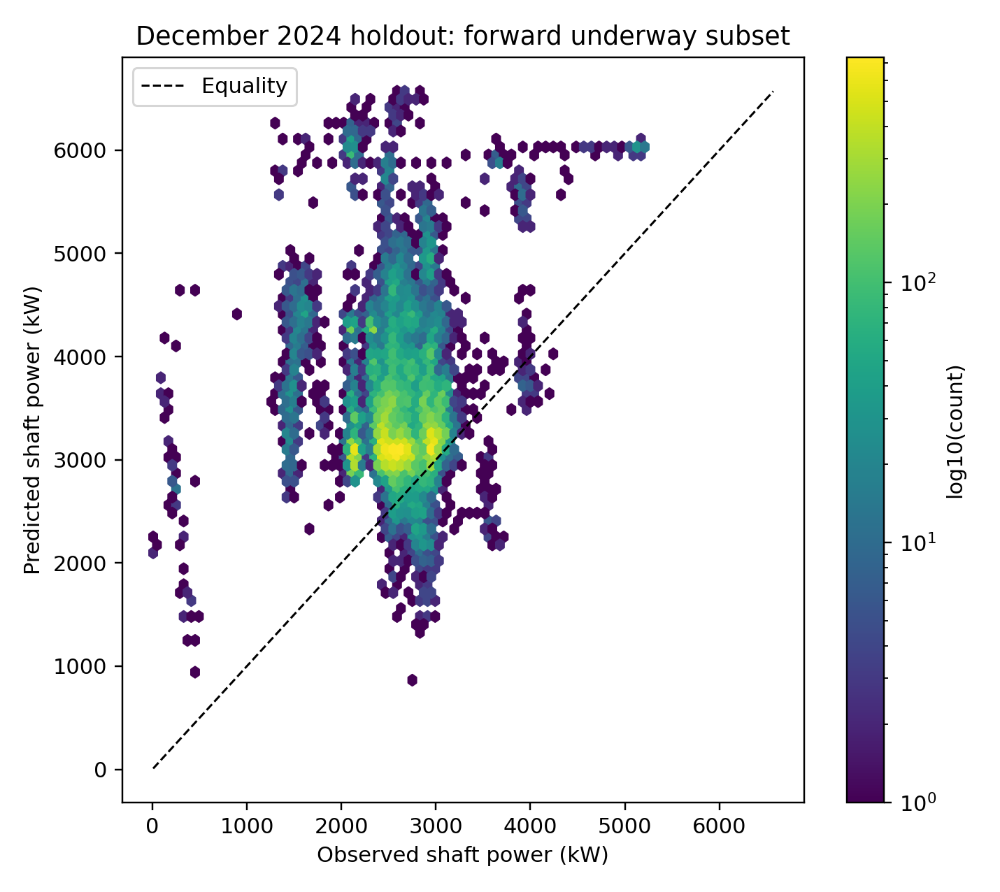
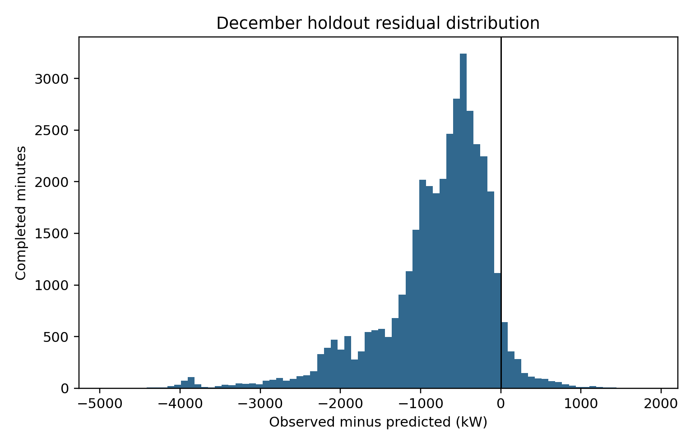
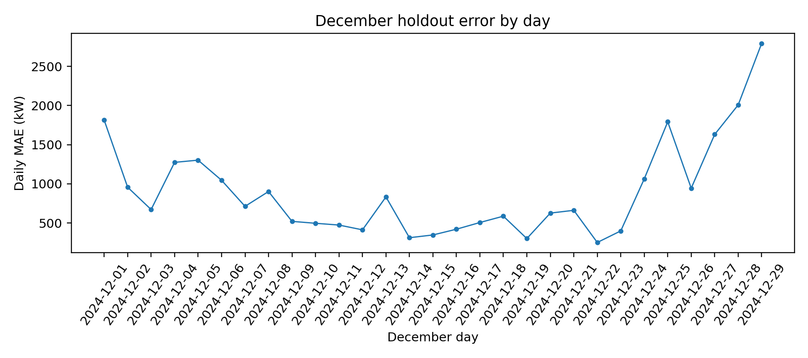
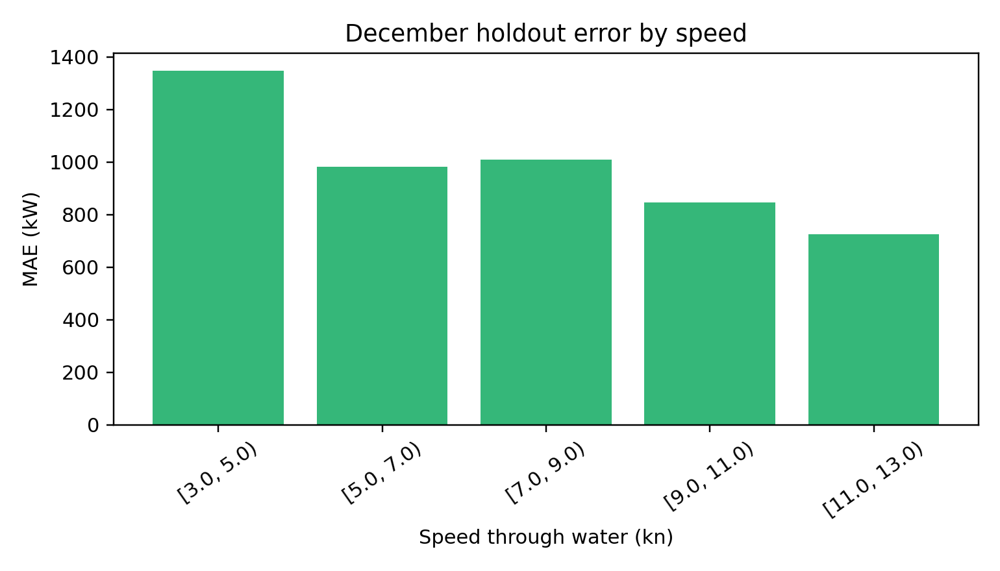
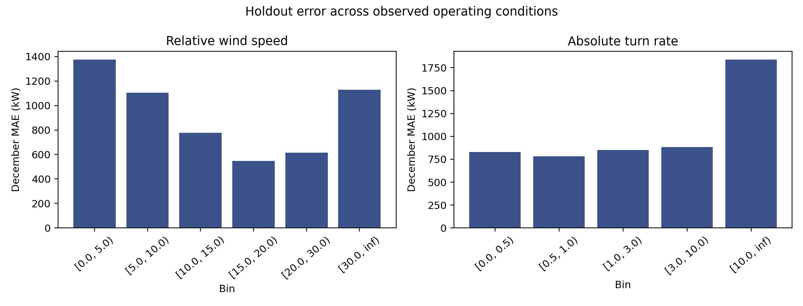

# Task 3 — Methods, Analysis and Technical Evaluation

**SINTEF Ocean Real Vessel Data Challenge · NTNU TDT4259 · technical draft, 25 October 2026**

**Status.** This is an executed CPU-only modelling and evaluation study, with a frozen August-selected configuration and one December holdout evaluation. It is suitable as a technical Task 3 draft. It does **not** establish operational deployment readiness, causally available provider weather, a validated torquemeter calibration, fuel savings, or a ship-specific physical speed–power law. The donor vessel must remain confidential.

## Executive findings

The selected approach was a histogram gradient boosting regressor using the six restricted onboard operational channels (16 transformed value, circular and count inputs). On August validation, the selection fit achieved **942.5 kW MAE**. A subsequent fit of the same frozen configuration on all **166,154** eligible January–June minutes achieved **910.9 kW MAE**, **1,113.1 kW RMSE** and **0.837 R** on August. The latter is descriptive after selection, not a second tuning criterion.

The one-time December holdout scored **822.3 kW MAE**, **1,064.4 kW RMSE**, and **0.004 R** on **39,270** headline minutes. It beat the training-mean and constrained speed-cubic baselines on MAE, yet December R was almost zero. Mean residual (observed minus predicted) was **-794.4 kW**: predictions were systematically high. Therefore the December result does not support a claim that this model tracks minute-scale power variation reliably. There was no post-test retuning.

The main scientific fragility is label scope. September–October headline MAE was **884.1 kW**, while the broader forward-speed subset, which retains zero and negative labels, had **2,009.8 kW MAE**. These are different estimands and must not be pooled or portrayed as equivalent performance. Negative power can reflect reverse operation, a sensor problem, or another mechanism; the data alone do not decide which.

## 1. Data, provenance and boundaries

The year-wide input is twelve confidential 2024 long-format CSVs with **41,079,968** records. January 2025 has no power target and is not used for supervised training or evaluation. Noon Reports are excluded from model features because their publication time relative to a prediction is unknown. The existing Task 1 and Task 2 preliminary reports, dictionary and QID map remain the reference for sensor provenance and quality context.

The streaming builder reads one monthly file at a time in 200,000-row chunks. It does not materialize the 42-million-row source or a union-timestamp pivot. Its 2024 output has **527,040** completed-minute rows, compressed into twelve files totalling **41.1 MB**. Every exported predictor is explicitly keyed by QID in `feature_manifest.json`. The four constant-zero draft channels, six torquemeter-associated inputs and the sparse depth channel are absent from the exported modelling table. The power target and separate label-quality fields remain for evaluation only; the fitted pipeline accepts only its explicit feature-column list.

For the row labelled time *t*, onboard channels use raw observations in **[t − 1 minute, t)** and are summarized at the interval end. Numeric scalar channels use arithmetic means. Heading and relative wind angle use vector sums of sine and cosine, then a circular mean; the model receives sine, cosine and resultant length, not an ordinary arithmetic mean of degrees. Onboard `n__` fields record raw observations per window. External provider channels use the latest raw timestamp strictly before the completed-minute end, with a maximum source age of 3,600 seconds; `age_s__` fields retain that provenance. No reading after *t* is used. This is a completed-minute reconstruction, not proof that every input existed at a real operational decision instant. Provider timestamps might denote valid time rather than issue time.

The input sensor values are numeric after parsing; the raw CSV stores text. Timezone semantics for 2024 `Z` timestamps are UTC. January 2025 timestamp timezone remains unverified, but January 2025 is outside this supervised study. The year-wide exact duplicate audit in Task 2 found no duplicate `(timestamp, QID)` keys. The Task 3 builder independently reconciles per-month source row and target-reading counts.

### Monthly build and target counts

| Month | Raw rows | Completed min | Target min | Min with negative target reading |
| --- | --- | --- | --- | --- |
| 2024-01 | 3,657,054 | 44,640 | 41,701 | 47 |
| 2024-02 | 3,510,816 | 41,760 | 41,649 | 36 |
| 2024-03 | 3,368,554 | 44,640 | 37,437 | 10 |
| 2024-04 | 3,517,849 | 43,200 | 42,795 | 8 |
| 2024-05 | 3,757,425 | 44,640 | 42,635 | 77 |
| 2024-06 | 3,527,867 | 43,200 | 40,550 | 0 |
| 2024-07 | 3,838,389 | 44,640 | 44,450 | 7,206 |
| 2024-08 | 3,764,623 | 44,640 | 44,640 | 181 |
| 2024-09 | 2,759,530 | 43,200 | 32,388 | 42 |
| 2024-10 | 1,935,036 | 44,640 | 22,088 | 11 |
| 2024-11 | 3,670,622 | 43,200 | 42,678 | 257 |
| 2024-12 | 3,772,203 | 44,640 | 44,160 | 49 |

The target-minute column counts completed minutes with at least one power observation; it is not an uptime percentage. September and October have lower target observation-count density, and this is evaluated separately. July and November remain available as source data and are quarantined from fitting and ranking because of target anomalies; their negative-reading counts alone do not diagnose the fault mechanism.

## 2. Split, label scope and leakage controls

The split was fixed before fitting: January–June training; July quality quarantine; August validation and model selection; September–October coverage stress; November quality quarantine; December untouched final holdout. There is no random split, and no December metric enters feature, hyperparameter or label-rule selection. The December evaluation script requires a saved frozen selection and refuses a second execution while its prediction artifact exists.

The predeclared headline estimand is forward underway completed minutes with speed through water at least 3 kn, an observed target, positive minute-mean target, nonnegative minimum raw target in that minute, and zero negative raw target readings in that minute. The 3 kn boundary defines operational scope; it is not claimed as a calibrated anomaly threshold. The broader sensitivity set keeps all target values at the same forward-speed boundary, including zero and negative values. These labels can be physically legitimate in different operations; retaining them in the broader analysis prevents silent deletion.

| Split | Calendar min | Target min | Forward min with target | Headline min | Headline / forward |
| --- | --- | --- | --- | --- | --- |
| train | 262,080 | 246,767 | 184,295 | 166,154 | 90.2% |
| validation | 44,640 | 44,640 | 41,205 | 35,086 | 85.1% |

These counts show that headline coverage differs by period. On August, **35,086** of **41,205** forward minutes with target meet the headline rule. Zero or negative target minutes at forward speed warrant vessel and sensor review. The headline metric must always be accompanied by its sample count and the broader-label sensitivity result.

Feature provenance is bounded by the completed-minute end. Target, target counts, target minimum, torquemeter RPM/torque/energy/thrust, draft and depth do not enter the model input array. Imputation indicators and medians are learned within each training pipeline on January–June only. Ridge scaling is fitted in that same pipeline. No global interpolation or imputation crosses the chronological partitions. A persistence baseline is omitted from the ranking because a prior trustworthy power reading at the decision instant is not verified; presenting it as deployable would assume the missing operational contract.

## 3. Model families and selection procedure

Three feature sets were compared. **A: restricted onboard** uses speed through water, speed over ground, true heading, turn rate, relative wind speed and relative wind angle. **B: extended onboard** adds four main-engine channels: scavenging-air pressure, turbocharger RPM transducer, fuel load and CAMS RPM. **C: exploratory weather** adds all fourteen provider channels to B. C is a retrospective sensitivity case because provider issue-time semantics are unresolved. All angular channels are encoded with sine and cosine; onboard angle concentration is retained as a quality descriptor.

The two baselines are the constant training mean and an empirical nonnegative speed-cubic function `P = a + b·STW³` with both coefficients fitted on training data by nonnegative least squares. The latter is a simple physically motivated comparator, not a first-principles propulsion law or an assertion of a monotone observed relationship in every regime. Ridge Regression uses training-only median imputation, missingness flags and scaling, with alpha 10 or 100. HistGradientBoostingRegressor uses training-only median imputation and missingness flags, 120 boosting iterations, learning rate 0.07, minimum leaf size 80, L2 regularization 1 and 15 or 31 leaves. Searches are intentionally small for an 8 GB CPU laptop.

For fair bounded comparison, each candidate was fitted to the same deterministic, uniformly spaced **120,000** eligible January–June rows, then scored on all eligible August rows. The primary selection statistic was August MAE; RMSE and Pearson R were reported but did not override MAE. The selected model was then refitted on all **166,154** eligible January–June rows. The baseline coefficients used in final stress and holdout evaluation were likewise fitted on all eligible training rows. No August, September, October, November or December labels entered the final model fit.

### August model comparison

| Feature set | Model | Setting | August n | MAE kW | RMSE kW | R |
| --- | --- | --- | --- | --- | --- | --- |
| A_restricted_onboard | histgb | 15 | 35,086 | 942.5 | 1,137.3 | 0.837 |
| A_restricted_onboard | histgb | 31 | 35,086 | 1,042.2 | 1,199.7 | 0.815 |
| B_extended_onboard | histgb | 31 | 35,086 | 1,165.7 | 1,172.3 | 0.989 |
| B_extended_onboard | histgb | 15 | 35,086 | 1,165.9 | 1,172.4 | 0.990 |
| C_exploratory_weather | histgb | 15 | 35,086 | 1,173.5 | 1,178.8 | 0.991 |
| C_exploratory_weather | ridge | 10.0 | 35,086 | 1,186.6 | 1,191.4 | 0.993 |
| baseline | speed_cubic | train_only | 35,086 | 1,187.9 | 1,262.5 | 0.728 |
| C_exploratory_weather | histgb | 31 | 35,086 | 1,193.0 | 1,198.0 | 0.991 |
| C_exploratory_weather | ridge | 100.0 | 35,086 | 1,196.0 | 1,200.5 | 0.993 |
| B_extended_onboard | ridge | 10.0 | 35,086 | 1,214.0 | 1,217.4 | 0.993 |
| B_extended_onboard | ridge | 100.0 | 35,086 | 1,219.7 | 1,223.0 | 0.992 |
| A_restricted_onboard | ridge | 100.0 | 35,086 | 1,297.5 | 1,385.7 | 0.631 |
| A_restricted_onboard | ridge | 10.0 | 35,086 | 1,297.7 | 1,385.9 | 0.631 |
| baseline | training_mean | train_only | 35,086 | 1,513.6 | 1,637.1 | undefined |

The restricted onboard boosting model had the lowest August MAE. Some extended configurations have high R but worse absolute error, which illustrates why correlation alone is not a sufficient power-estimation criterion. The August comparison is a chronological validation result, not evidence of generalization to all operating periods.

## 4. Coverage stress and untouched holdout

| Period | Label scope | Model | n | MAE kW | RMSE kW | R |
| --- | --- | --- | --- | --- | --- | --- |
| Sep-Oct | headline | selected_model | 38,517 | 884.1 | 997.5 | 0.923 |
| Sep-Oct | headline | training_mean | 38,517 | 1,600.0 | 2,023.7 | undefined |
| Sep-Oct | headline | speed_cubic | 38,517 | 1,387.1 | 1,649.9 | 0.803 |
| Sep-Oct | broader_forward | selected_model | 52,502 | 2,009.8 | 2,839.2 | 0.253 |
| Sep-Oct | broader_forward | training_mean | 52,502 | 2,555.8 | 3,189.9 | undefined |
| Sep-Oct | broader_forward | speed_cubic | 52,502 | 2,334.9 | 2,922.5 | 0.461 |
| December | headline | selected_model | 39,270 | 822.3 | 1,064.4 | 0.004 |
| December | headline | training_mean | 39,270 | 2,568.4 | 2,592.9 | undefined |
| December | headline | speed_cubic | 39,270 | 1,944.2 | 1,989.1 | 0.191 |
| December | broader_forward | selected_model | 39,313 | 823.8 | 1,066.8 | 0.020 |
| December | broader_forward | training_mean | 39,313 | 2,571.3 | 2,597.3 | undefined |
| December | broader_forward | speed_cubic | 39,313 | 1,945.9 | 1,991.4 | 0.213 |

Pearson R for the constant training-mean baseline is undefined and intentionally blank. The December headline covers **39,270** of **39,313** forward minutes with target, and **44,160** of **44,640** calendar minutes have any target reading. The broader December sensitivity differs little from the headline because only **43** forward minutes with target fall outside the positive-label rule. September–October is very different: the broader set contains **13,985** additional forward minutes with zero or negative label conditions, and the selected model's MAE rises sharply. This must be investigated before claiming coverage across operating states.

The December observed target has mean **2,619.9 kW** and standard deviation **355.7 kW** on headline minutes; predictions have mean **3,414.4 kW** and standard deviation **614.0 kW**. The much lower observed variation and negative mean residual are consistent with a period shift, calibration difference, operating-state difference, or missing explanatory variables. These are hypotheses, not diagnosed causes. No December-based correction has been applied.

### Error distribution and temporal blocks

Residual means observed minus predicted. The saved prediction table contains the exact one-time December predictions, labels, speed, target-quality indicators and weather-presence flags. Its residual quantiles are:

| Residual quantile | Observed minus predicted, kW |
| --- | --- |
| 0.01 | -3,368.2 |
| 0.05 | -2,150.6 |
| 0.25 | -1,054.9 |
| 0.5 | -633.7 |
| 0.75 | -345.4 |
| 0.95 | 5.0 |
| 0.99 | 490.7 |

There are **29** calendar days with at least one headline minute in December. The largest five daily MAEs are shown below; days with few observations should not be interpreted as equally precise estimates. Daily blocks expose persistence of errors that per-minute counts conceal.

| Date | n | MAE kW | Bias kW |
| --- | --- | --- | --- |
| 2024-12-29 | 460 | 2,794.1 | -2,794.1 |
| 2024-12-28 | 444 | 2,007.6 | -2,007.6 |
| 2024-12-01 | 1,439 | 1,813.9 | -1,806.0 |
| 2024-12-25 | 1,440 | 1,791.8 | -1,791.8 |
| 2024-12-27 | 1,420 | 1,631.0 | -1,631.0 |

### Speed and operating conditions

| STW kn | n | MAE kW | Bias kW |
| --- | --- | --- | --- |
| [3.0, 5.0) | 17 | 1,346.4 | -1,346.4 |
| [5.0, 7.0) | 121 | 981.9 | -650.1 |
| [7.0, 9.0) | 3,510 | 1,010.3 | -779.7 |
| [9.0, 11.0) | 22,933 | 846.6 | -838.3 |
| [11.0, 13.0) | 12,689 | 724.3 | -719.9 |

The following descriptive bins add relative wind speed, absolute turn rate and speed over ground. Bins were computed after the holdout evaluation for diagnosis only; they were not used to change the fitted model or headline scope. Sparse bins carry large uncertainty.

| Condition | Bin | n | MAE kW | Bias kW |
| --- | --- | --- | --- | --- |
| relative_wind_kn | [0.0, 5.0) | 3,103 | 1,374.6 | -1,373.2 |
| relative_wind_kn | [5.0, 10.0) | 2,955 | 1,105.5 | -1,097.8 |
| relative_wind_kn | [10.0, 15.0) | 2,575 | 778.4 | -760.1 |
| relative_wind_kn | [15.0, 20.0) | 4,949 | 546.6 | -520.1 |
| relative_wind_kn | [20.0, 30.0) | 17,506 | 615.7 | -567.4 |
| relative_wind_kn | [30.0, inf) | 8,088 | 1,128.9 | -1,123.3 |
| absolute_turn_degmin | [0.0, 0.5) | 24,176 | 828.5 | -815.3 |
| absolute_turn_degmin | [0.5, 1.0) | 8,986 | 782.2 | -757.7 |
| absolute_turn_degmin | [1.0, 3.0) | 5,447 | 852.6 | -778.2 |
| absolute_turn_degmin | [3.0, 10.0) | 653 | 883.1 | -649.9 |
| absolute_turn_degmin | [10.0, inf) | 8 | 1,838.0 | -1,753.7 |
| speed_over_ground_kn | [0.0, 3.0) | 1 | 1,012.9 | -1,012.9 |
| speed_over_ground_kn | [3.0, 5.0) | 23 | 1,521.4 | -1,521.4 |
| speed_over_ground_kn | [5.0, 7.0) | 362 | 843.6 | -614.7 |
| speed_over_ground_kn | [7.0, 9.0) | 5,760 | 914.0 | -749.9 |
| speed_over_ground_kn | [9.0, 11.0) | 25,557 | 812.8 | -811.5 |
| speed_over_ground_kn | [11.0, 13.0) | 7,567 | 781.7 | -777.0 |

### Weather availability sensitivity

| Period | Scope | n | All 14 fresh | Any fresh |
| --- | --- | --- | --- | --- |
| stress | headline | 38,517 | 100.0% | 100.0% |
| stress | broader_forward | 52,502 | 100.0% | 100.0% |
| test | headline | 39,270 | 100.0% | 100.0% |
| test | broader_forward | 39,313 | 100.0% | 100.0% |

All fourteen provider columns are fresh under the retrospective **raw-timestamp age ≤ 60 minutes** rule in the evaluated forward subsets. This is a data-coverage fact, not evidence that the values had actually been issued by those times. The winning model uses no external weather features, so weather availability does not alter its December predictions. Feature set C performed worse than A on August MAE; provider causality and real-time availability still require metadata before any operational use.

## 5. Technical validity, resource use and reproducibility

The feature pass took **139.7 seconds** summed over months on this machine; the twelve bounded candidate model fits took **22.7 seconds** summed over fit calls, and the final selected fit took **1.8 seconds**. Stress plus one-time holdout evaluation and figure generation took **4.7 seconds**. These timings are local observations and exclude environment setup and report writing. Peak RAM was not measured. The implementation limits raw ingestion to 200,000 rows per chunk, materializes at most one monthly minute grid in the builder, and limits selection fits to 120,000 rows; it uses CPU-only scikit-learn and compact compressed CSV outputs. The final fitted pipeline is serialized with joblib.

Task 3's executable QA currently records **18 PASS** and **0 FAIL**. It includes synthetic boundary cases for no future within-window onboard values, no future provider value, circular 350°/10° aggregation; source row and target-count reconciliation; QID and feature exclusions; provider age bounds; frozen split and model-input checks; independent recomputation of December MAE/RMSE/R from saved predictions; and undefined-R handling for constant baselines. The Task 1/2 checklist remains a separate preliminary audit and is not replaced by this Task 3 checklist.

Reproduction from the project root follows `outputs/task3/README.md`: scripts 11, 12, 13, 14, 15 and 16 in order. Script 13 will refuse to overwrite the holdout predictions. A fresh rerun intended as a new experiment should preserve this completed holdout and use a clearly versioned experiment directory; it must not silently retune on December.

## 6. Remaining scientific limitations and next work

1. **Power-label validity.** The mechanism and exact boundaries of July and November anomalies remain unknown. August's forward-speed zero/negative labels and September–October's much larger broader-label error also require investigation. Calibration and operations logs are needed before expanding the headline scope or asserting which negative values are faults.
2. **Temporal availability.** Onboard features describe a completed minute. Engine-signal and target operational latency were not established. Provider timestamp issue, validity and timezone semantics remain unknown; external-feature results are exploratory and must not be marketed as causal real-time forecasts.
3. **December transfer.** December R near zero and a sizeable negative bias demonstrate weak transfer of minute-scale variation, despite MAE beating the two simple baselines. Test findings may motivate a *new* future protocol and new holdout, but December cannot be reused for tuning this reported experiment.
4. **Dependence and uncertainty.** Adjacent minute errors are autocorrelated, weather timestamps repeat across minutes, and vessel operating periods are clustered. Per-minute sample counts are not independent trials. Day or voyage-block uncertainty estimates should accompany later comparative claims.
5. **Scope and outcomes.** No fuel-consumption target, cost, emissions or intervention was validated here. No fuel saving, route optimization benefit, or causal effect is estimated. These findings should inform Tasks 4–6 only as a reproducible technical starting point.

For Tasks 4–6, reuse the explicit QID manifest, minute-window contract, frozen split, label-scope flags, saved model-comparison tables, residual diagnostics and the conservative availability caveats. The next scientific gate is to reconcile target calibration and operational timestamps with vessel/provider metadata, then define a new prospective or later-period holdout before changing the model. The present December holdout is spent for this experiment.

## Artifact index

- `data/minute_2024_MM.csv.gz`: twelve reusable one-minute tables; `tables/feature_manifest.json`: QID/source and interval contract.
- `tables/feature_build_summary.csv`, `label_scope_train_validation.csv`, `validation_model_comparison.csv`, `frozen_selection.json`: build, coverage, selection and frozen protocol.
- `models/selected_pipeline.joblib`: selected, training-only fitted pipeline and metadata.
- `tables/stress_metrics.csv`, `test_metrics.csv`, `test_predictions.csv.gz`, `test_daily_error.csv`, `test_speed_error.csv`, `test_operating_condition_error.csv`, `test_distribution_diagnostic.csv`, `weather_availability_sensitivity.csv`: genuine validation and holdout evidence.
- `figures/`: plots drawn from saved December results; `tables/task3_qa.csv`: executable check results; `README.md`: commands and safeguards.

**Interpretation rule:** all metrics are period-, label-scope- and availability-dependent. Do not reuse a headline number without its split, sample count and unresolved limitations.
